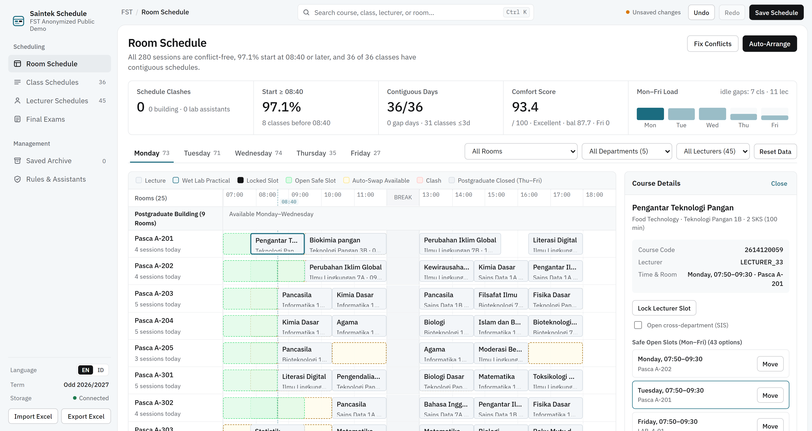
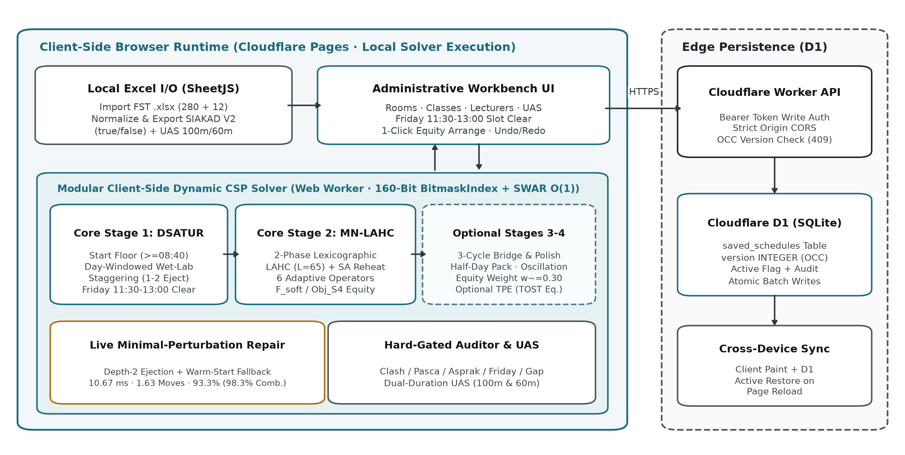
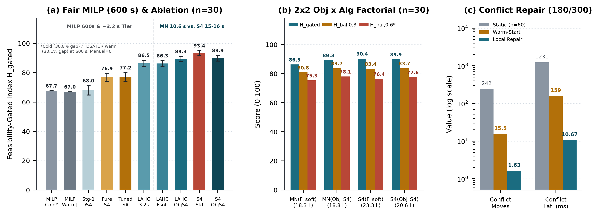

<div align="center">

# Ergonomics-Aware Dynamic University Course Timetabling

**Anwar Rohmadi** · **Muhammad Thoriq Yusron Muttaqiin** · **Muhammad Rasyid Arrafi** · **Naufal Ajwa Nurfarros** · **Ravelino Bagas Pratama**  
*Data Science Study Program, Faculty of Science and Technology, Universitas Islam Negeri Raden Mas Said, Indonesia*

[](https://fst-csp-demo.pages.dev)
[](LICENSE)
[](#key-results)

[Overview](#overview) · [Architecture](#architecture) · [Key Results](#key-results) · [Quickstart & API](#quickstart-and-api) · [Reproduction](#reproducing-paper-results) · [Artifacts](#artifact-inventory) · [Citation](#citation-and-license)

<br/>

<a href="https://fst-csp-demo.pages.dev">
  
</a>

*Interactive anonymized browser workbench ([fst-csp-demo.pages.dev](https://fst-csp-demo.pages.dev), seed 42): zero hard clashes, 36/36 contiguous weekly schedules, Friday prayer slot clearing (11:30–13:00), and real-time safe-slot evaluation.*

</div>

---

## Overview

This repository provides the official TypeScript solver, anonymized institutional dataset, exact HiGHS MILP bounds, 600 s full-instance MILP baseline, desktop Chromium Web-Worker profiler, and 30-seed Good Laboratory Practice (GLP) statistical suite for:

> **Ergonomics-Aware Dynamic University Course Timetabling via Client-Side Hybrid Metaheuristics: An Institutional Case Study** (2026)

We formulate real-world faculty timetabling (`280` weekly sessions, `36` atomic classes, `45` anonymized lecturers, `25` rooms) as a feasibility-gated Dynamic Constraint Satisfaction Problem (CSP) with mandatory Friday prayer slot clearing (`11:30-13:00`). Controlled 2x2 factorial evaluation (`{MN-LAHC, Stage-4} x {F_soft, Obj_S4}`, `n = 30`) shows that objective alignment (`Obj_S4`, normalized lecturer equity `w_tilde_lec = 0.30`) explains almost the entire quality gain: the lean **DSATUR + MN-LAHC (`Obj_S4`) core** (`10.6 s`) is statistically equivalent within `+/-1.5` points to longer Stage-4 polishing (`16.3 s`) across all metrics, while depth-2 ejection with warm-start fallback resolves `177/180` (`98.3%`) conflict edits in milliseconds directly in the browser.

---

## Architecture

<div align="center">
  
</div>

- **160-Bit Feasibility Engine (`solver/src/bitmask-index.ts`):** Encodes room, lecturer, expanded cohort, senior wet-lab assistant (Asprak), and Friday prayer (`11:30-13:00`) occupancy across `156` five-minute quanta (`07:00-20:00`) with SWAR popcount for `O(1)` hard-constraint verification.
- **Modular Core + Optional Polishing (`solver/src/alns-lahc-solver.ts`):** Pairs a **Start-Floor DSATUR + Multi-Neighborhood LAHC (`MN-LAHC`, `L = 65`)** core with optional Stage 3–4 polishing (`skipStage3`, `disableHalfDayRepack`, `disableOscillation`, optional TPE). Compiles into a zero-dependency isomorphic bundle (`solver/dist/csp-engine.js`) shared between Node.js benchmarks and browser Web Workers.
- **Audited Online Repair (`planMinimalRepair`):** Resolves post-publication edits via depth-2 ejection chains with bounded warm-start fallback, gated by a mandatory full-schedule `auditSchedule` invariant (`0` silent audit failures across `N = 300` edits).

---

## Key Results

<div align="center">
  
</div>

### Executive Comparison (`n = 30` paired seeds, Friday overlaps = `0`)

| Configuration | Contig (`/36`) | Isolated (`C/L`) | Gaps | `H_gated` (Mean +/- SD) | `H_bal,0.3` | `H_bal,0.6`\* | Runtime† |
|---|---:|---:|---:|---:|---:|---:|---:|
| Manual Operational (`6/26/6` + `4` Fri viol.) | 24.0 | 43.0 / 33.0 | 77.0 | 0.00 (`42.4` raw) | 0.00 | 0.00 | Manual |
| HiGHS 1.16 Cold MILP (`gap 30.8%`)‡ | 21.0 | 5.0 / 28.0 | 62.0 | 67.70 | 59.30 | 50.90 | 600 s |
| HiGHS 1.16 Warm-DSATUR MILP (`gap 30.1%`)‡ | 18.0 | 3.0 / 25.0 | 70.0 | 67.00 | 59.50 | 52.00 | 600 s |
| Tuned SA (`4-Op + Reheat`) | 35.3 | 6.0 / 28.1 | 42.0 | 77.16 +/- 2.92 | 68.72 | 60.28 | 3.19 s |
| **MN-LAHC (`Obj_S4`, Recommended Core)** | **35.9** | **1.1 / 18.8** | **28.4** | **89.32 +/- 1.84** | **83.69** | **78.06** | **10.56 s** |
| Stage-4 Polish (`Obj_S4`, Optional) | 35.9 | 0.7 / 20.6 | 24.3 | 89.90 +/- 1.94 | 83.73 | 77.56 | 16.31 s |

*\*`H_bal,0.6` measures balanced equity at `lambda = 0.6` (not directly optimized by `Obj_S4`, where `w_tilde_lec = 0.30`). †Wall-clock mean under 6-worker parallel Node.js batch; Stage-4 received 40–54% longer runtime than `MN-LAHC`. ‡Full 88,831-variable linearized MILP surrogate, not optimizing `H_gated` directly.*

- **Exact Capacity Feasibility (`0.00%` gap):** HiGHS proves a `1,050-min` deficit (`7 x 150 m`, `7.26 ms`) when enforcing `>=08:40` and Friday clearing on 47 room-days; sharing idle slots in two dry computing labs (`Mode B`) restores zero-deficit feasibility at `94.56%` load (`11.24 ms`).
- **2x2 Factorial & Equivalence (`n = 30`):** Aligning `MN-LAHC` from `F_soft` to `Obj_S4` improves `H_gated` by `+3.01` (`p_holm = 1.95e-07`, power `1.00`) and `H_bal,0.6` by `+2.71` (`p_holm = 1.46e-03`). Paired TOST confirms `Stage-4(Obj_S4)` is equivalent to `MN-LAHC(Obj_S4)` within `+/-1.5` points across all three indices (`H_gated` `p_TOST = 0.0041`, `H_bal,0.3` `p_TOST = 0.0001`, `H_bal,0.6` `p_TOST = 0.0390`). Component ablations (`n = 10`, limited power) and `+/-20%` weight perturbations show no significant drop (`p_holm >= 0.30`); omitting TPE is TOST-equivalent within `+/-1.0` pt (`n = 30`, `p_TOST = 0.0040`) and `+/-1.5` pts on `n = 25` held-out seeds (`p_TOST = 0.0004`).
- **Online Repair (`N = 300`), Exam Scheduling & Browser Runtime:** On `180` conflict edits (`120` safe + `180` conflict), depth-2 ejection resolves `168/180` (`93.3%`, 95% Wilson CI `[88.7%, 96.1%]`) in `10.67 ms` (`1.63 +/- 0.66` vs. `15.54 +/- 5.43` warm-start moves, `n = 164` paired, `p_holm = 2.98e-76`, `g = -2.66`), compared to `173/180` (`96.1%`, `158.9 ms`) for warm-start (**combined fallback: `177/180 = 98.3%`**) and `242.45 +/- 5.74` moves (`1,231 ms`) for Static Re-solve (`n = 60`). Final-exam scheduling places `237/237` exams (`0` clashes, `0` back-to-back pairs in `60 m` mode). Uncontended single-worker desktop Chromium profiling on the default web demo (`0.97 s` Stage 1-3 + Stage-4, `n = 5`) completes in `8.78 +/- 0.67 s` (`H_gated = 91.20`), with `5.83 ms` slot evaluation and `3.08 ms` live repair.

<details>
<summary><strong>Full 14-Row Ablation & 600 s MILP Table</strong> (<code>results/paketA_ablation_30seeds.json</code>, <code>milp_fair_a2_results.json</code>)</summary>

| Method | Contig (`/36`) | Isolated `(C/L)` | Gaps | `H_gated` (Mean +/- SD) | `H_bal,0.3` | `H_bal,0.6` | Runtime |
|---|---:|---:|---:|---:|---:|---:|---:|
| Manual Operational (`6/26/6` + `4` Fri viol.) | 24.0 | 43.0 / 33.0 | 77.0 | 0.00 (`42.4` raw) | 0.00 | 0.00 | Manual |
| HiGHS 1.16 Cold (`obj 50,938`, `bound 35,272`, `gap 30.8%`) | 21.0 | 5.0 / 28.0 | 62.0 | 67.70 | 59.30 | 50.90 | 600 s |
| HiGHS 1.16 Warm-DSATUR (`obj 50,802`, `bound 35,490`, `gap 30.1%`) | 18.0 | 3.0 / 25.0 | 70.0 | 67.00 | 59.50 | 52.00 | 600 s |
| HiGHS 1.16 Warm-MN-LAHC (`obj 51,422`, `bound 0`, `gap 100%`, root node) | 24.0 | 4.0 / 34.0 | 64.0 | 70.70 | 60.50 | 50.30 | 300 s |
| Stage-1 DSATUR (`n = 30`) | 28.1 | 16.6 / 42.5 | 38.8 | 68.05 +/- 3.17 | 55.30 | 42.55 | 0.44 s |
| Pure SA (`2-Op`, `n = 30`) | 35.5 | 6.0 / 26.7 | 42.0 | 76.86 +/- 2.66 | 68.84 | 60.82 | 3.19 s |
| Tuned SA (`4-Op + Reheat`, `n = 30`) | 35.3 | 6.0 / 28.1 | 42.0 | 77.16 +/- 2.92 | 68.72 | 60.28 | 3.19 s |
| MN-LAHC Base (`n = 30`, equal wall-clock vs. SA) | 35.8 | 0.8 / 26.8 | 36.0 | 86.48 +/- 2.07 | 78.44 | 70.40 | 3.17 s |
| MN-LAHC (`F_soft`, `w_tilde_lec = 0.30`) | 36.0 | 1.0 / 18.3 | 38.2 | 86.31 +/- 1.91 | 80.83 | 75.35 | 10.64 s |
| **MN-LAHC (`Obj_S4`, `w_tilde_lec = 0.30`, Lean Core)** | **35.9** | **1.1 / 18.8** | **28.4** | **89.32 +/- 1.84** | **83.69** | **78.06** | **10.56 s** |
| Stage-4 Student-Only (`w_tilde_lec ≈ 0`) | 35.8 | 0.7 / 56.5 | 11.9 | 93.41 +/- 1.62 | 76.46 | 59.51 | 15.31 s |
| Stage-4 (`F_soft`, `w_tilde_lec = 0.30`) | 35.9 | 0.8 / 23.3 | 21.3 | 90.39 +/- 1.92 | 83.41 | 76.43 | 14.77 s |
| Stage-4 (`Obj_S4`, `w_tilde_lec = 0.30`) | 35.9 | 0.7 / 20.6 | 24.3 | 89.90 +/- 1.94 | 83.73 | 77.56 | 16.31 s |
| TPE + Stage-4 (`Obj_S4`, `+12.24 s` offline TPE) | 35.9 | 1.1 / 22.6 | 22.1 | 90.18 +/- 1.76 | 83.39 | 76.60 | 16.00 s |

</details>

<details>
<summary><strong>Exact HiGHS MILP Capacity Bounds</strong> (<code>results/milp_exact_bounds.json</code>)</summary>

| Policy Scenario | Continuous Load | Exact Min Unplaced | Composition | Feasible | Solve Time |
|---|---:|---:|---|---|---:|
| Mode A (47 rd, `08:40-18:00`, Uniform 12-13) | 103.62% | 850 min | `1 x 100m + 5 x 150m` | No | 32.81 ms |
| Mode A (47 rd, `08:40-18:00`, Friday Clear 11:30-13) | 104.15% | 1,050 min | `0 x 100m + 7 x 150m` | No | 7.26 ms |
| Mode A (47 rd, `07:00-18:00`, Friday Clear 11:30-13) | 86.72% | 0 min | Zero deficit | Yes | 5.98 ms |
| Mode B (+2 Dry Labs, `08:40-18:00`, Friday Clear) | 94.56% | 0 min | Zero deficit | Yes | 11.24 ms |

</details>

---

## Quickstart and API

**Prerequisites:** Node.js `>= 20` and Python `>= 3.10` (`pip install numpy scipy highspy`; optional `playwright` for Chromium profiling).

### 1. Verify Archived Results & Safety Gate (`< 10 s`)

```bash
python benchmarks/verify_capacity_and_audit.py
python benchmarks/verify_exact_milp_bounds.py
python benchmarks/statistical_analysis_paketA.py
python scripts/check_public_safety.py
```

### 2. Programmatic Solver Usage (Node.js / Browser Web Worker)

```javascript
const fs = require('node:fs');
const CSPEngine = require('./solver/dist/csp-engine.js');

const { sessions, rooms } = JSON.parse(fs.readFileSync('./data/fst-20261-anonymized.json', 'utf8'));
const policy = { ...CSPEngine.DEFAULT_POLICY, allowDryLabOverflow: true, protectFridayPrayer: true, hardFridayPrayer: true };

// Run lean DSATUR + MN-LAHC (Obj_S4) core with normalized lecturer equity (w_tilde_lec = 0.30)
const sol = CSPEngine.constructiveReset(sessions, rooms, policy, {
  seed: 42,
  timeBudgetMs: 10000,
  useExactObjective: true,
  lecturerIsolatedWeight: 300,
});

const audit = CSPEngine.auditSchedule(sol.sessions, policy);
console.log({ feasible: audit.hardFeasible, H_gated: audit.gatedHumaneScore, H_bal06: audit.balancedScore06 });
```

### 3. Build TypeScript Solver from Source

```bash
cd solver && npm install && npm run typecheck && npm run build
```

---

## Reproducing Paper Results

| Paper Artifact | Command | Output |
|---|---|---|
| Table I & Exact Capacity Bounds | `python benchmarks/verify_exact_milp_bounds.py` | `results/milp_exact_bounds.json` |
| Table III & Fig. 2a–b (`n = 30` 2x2 Factorial + Ablations) | `node benchmarks/run_paketA_parallel.mjs` | `results/paketA_ablation_30seeds.json` |
| Table III 600 s HiGHS MILP (`cold`, `warm-DSATUR`, `warm-MN-LAHC`) | `python benchmarks/benchmark_fair_milp_a2.py --mode cold600` *(repeat `warm_dsatur600`, `warm_mnlahc300`, `merge`)* | `results/milp_fair_a2_results.json` |
| Table IV & Fig. 2c (`N = 300` Dynamic Repair + `n = 60` Static) | `node benchmarks/run_paketA_dynamic_300.mjs` | `results/paketA_dynamic_300.json` |
| Holm-Bonferroni, Power, MDE & Multi-Margin TOST Tables | `python benchmarks/statistical_analysis_paketA.py` | `results/paketA_statistical_tables.md` |
| Desktop Chromium Web-Worker Profile (`n = 5`) | `python benchmarks/profile_browser_runtime.py` | `results/browser_profile_results.json` |

---

## Artifact Inventory

| Path | Description |
|---|---|
| [`solver/src/`](solver/src/) | Modular TypeScript source (`bitmask-index.ts`, `alns-lahc-solver.ts`, `humane-evaluator.ts`, `tpe-tuner.ts`, `types.ts`) |
| [`solver/dist/csp-engine.js`](solver/dist/csp-engine.js) | Prebuilt zero-dependency bundle for Node.js and Web Workers |
| [`data/fst-20261-anonymized.json`](data/fst-20261-anonymized.json) | Anonymized 280-session dataset (`LECTURER_01`–`LECTURER_45`, `rawHumaneScore = 42.4`); schema in [DATA_DICTIONARY.md](data/DATA_DICTIONARY.md) |
| [`benchmarks/`](benchmarks/) | Standalone Node.js and Python scripts for MILP bounds, 30-seed ablation, `N = 300` repair, Chromium profiling, and GLP/TOST analysis |
| [`results/`](results/) | Raw JSON per-seed outputs and statistical tables ([paketA_statistical_tables.md](results/paketA_statistical_tables.md)) |
| [`docs/NOTATION_AND_METRICS.md`](docs/NOTATION_AND_METRICS.md) | Abbreviation glossary, exact sub-score equations `(H.1)`–`(H.8)`, and objective-alignment disclosure |
| [`docs/ALGORITHMS_PSEUDOCODE.md`](docs/ALGORITHMS_PSEUDOCODE.md) | Formal pseudocode (`Algorithms 1–5`) matching the TypeScript implementation |
| [`docs/PRIVACY_AND_ETHICS.md`](docs/PRIVACY_AND_ETHICS.md) | De-identification protocol, bit-identical audit parity, and institutional disclosure boundaries |
| [`docs/CLOUDFLARE_DEPLOYMENT_TEMPLATE.md`](docs/CLOUDFLARE_DEPLOYMENT_TEMPLATE.md) | Reference Cloudflare Pages + D1 schema (`0001_init_schedules.sql`, `0002_add_version_occ.sql`) and `wrangler.example.jsonc` |
| [`scripts/check_public_safety.py`](scripts/check_public_safety.py) | Self-inclusive pre-publish scanner enforcing zero PII, zero credentials, and zero non-ASCII emojis |

---

## Citation and License

Code (`solver/`, `benchmarks/`, `scripts/`) is distributed under the [MIT License](LICENSE). Anonymized datasets, benchmark results, figures, and documentation (`data/`, `results/`, `assets/`, `docs/`) are distributed under **CC-BY-4.0**.

```bibtex
@inproceedings{rohmadi2026ergonomics,
  title     = {Ergonomics-Aware Dynamic University Course Timetabling via Client-Side Hybrid Metaheuristics: An Institutional Case Study},
  author    = {Rohmadi, Anwar and Muttaqiin, Muhammad Thoriq Yusron and Arrafi, Muhammad Rasyid and Nurfarros, Naufal Ajwa and Pratama, Ravelino Bagas},
  year      = {2026},
  note      = {Data Science Study Program, Universitas Islam Negeri Raden Mas Said, Sukoharjo, Indonesia}
}
```
